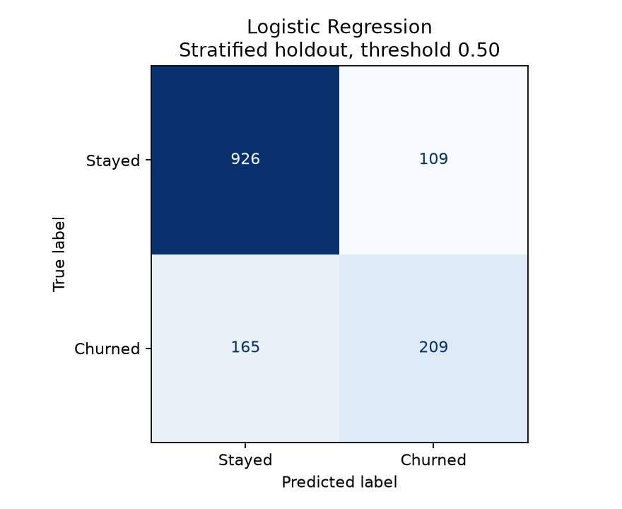

# Telco Customer Churn Prediction

Compare classification models for identifying customers at risk of churn. This version corrects preprocessing leakage, adds stratified cross-validation and replaces the earlier evaluation results.

## Data

The public Telco Customer Churn dataset contains 7,043 customers and a binary churn label. The CSV is included as `WA_Fn-UseC_-Telco-Customer-Churn.csv`. There are 11 blank `TotalCharges` values; these are converted to missing values and imputed using training-only medians. Customer IDs are unique and excluded from model features.

## Reproduce

Tested with Python 3.13.14. From this repository folder:

```bash
python -m venv .venv
# Windows: .venv\Scripts\activate
# macOS/Linux: source .venv/bin/activate
python -m pip install -r requirements.txt
python evaluate.py
```

Or open `telco-customer-churn-prediction.ipynb` in Jupyter and run all cells. The notebook imports the readable implementation in `evaluate.py`; keep both files together. Saved outputs are included for readers who do not run Python.

## Evaluation design

1. Apply only stateless numeric parsing before splitting. Exclude customer ID and target from inputs.
2. Reserve a stratified 20% holdout: 5,634 training customers and 1,409 test customers, including 374 test churners. Random seed is 42.
3. Put imputation, scaling and categorical encoding inside each scikit-learn Pipeline. Fit them afresh on the training portion of every cross-validation fold. Unknown categories are handled without refitting on validation or test data.
4. Compare a majority baseline, Logistic Regression, Random Forest and class-weighted Random Forest using five shuffled stratified folds on training data only.
5. Choose the model with highest mean cross-validation average precision, using F1 to break ties. This ranking metric considers precision and recall across thresholds, without selecting an all-positive classifier simply for high recall. This rule is defined before holdout scoring.
6. Fit the selected pipeline on all training data and evaluate it at the fixed 0.50 threshold on the holdout. Do not select models or thresholds using holdout performance.

### Training cross-validation

Average precision is reported as mean +/- sample standard deviation across folds. Other columns are fold means at the model's default classification threshold. A fold standard deviation is not a confidence interval.

| Model | Average precision | Precision | Recall | F1 |
|---|---:|---:|---:|---:|
| Majority baseline | 0.265 +/- 0.000 | 0.000 | 0.000 | 0.000 |
| Logistic Regression | 0.661 +/- 0.021 | 0.655 | 0.544 | 0.594 |
| Random Forest | 0.616 +/- 0.032 | 0.632 | 0.476 | 0.543 |
| Balanced Random Forest | 0.622 +/- 0.032 | 0.581 | 0.647 | 0.612 |

### Selected model holdout results

Selected model: **Logistic Regression**.

| Metric | Value |
|---|---:|
| ROC AUC | 0.842 |
| Average precision | 0.635 |
| Churn precision | 65.7% |
| Churn recall | 55.9% |
| F1 | 0.604 |
| Accuracy | 80.6% |
| Correctly flagged churners | 209 |
| Missed churners | 165 |
| False alarms | 109 |
| Correctly identified non-churners | 926 |



The balanced Random Forest has higher training-CV recall but lower precision and average precision. Logistic Regression wins under the stated ranking criterion; it is not a claim that one model is best for every retention budget. At the fixed threshold, it misses 165 of 374 churners. Retention costs, contact capacity and intervention effectiveness were not supplied, so no savings or business impact is claimed. Threshold tuning is future work and must use training-only out-of-fold predictions or a separate validation set.

## Verification and limitations

- Assertions verify unique customers, disjoint train/test and CV partitions, training-only imputation statistics and training-only scaler statistics.
- `results/cross_validation.csv`, `results/holdout_metrics.json` and `results/run_metadata.json` contain the detailed results, versions, seed and dataset hash.
- The notebook and command-line script are executed locally. These are benchmark results, not production or external validation.
- This public dataset was explored in the earlier project. The revised split is held out within this workflow, but is not a newly collected independent validation dataset.
- The earlier 61% recall result is superseded. The split, missing-value treatment and preprocessing have changed, so this is not a controlled before/after comparison of model quality.
- The dataset is a snapshot: no temporal validation or causal conclusions about retention interventions are supported.
- This evaluation revision was prepared with AI assistance and executed locally; the original portfolio project remains the basis of the work.

## Files

- `evaluate.py`: data preparation, pipelines, cross-validation, selection, holdout evaluation and assertions.
- `telco-customer-churn-prediction.ipynb`: explanation and executed results.
- `requirements.txt`: pinned runtime versions used for this run.
- `results/`: generated metrics and confusion matrix.

Method reference: [scikit-learn guidance on data leakage and pipelines](https://scikit-learn.org/stable/common_pitfalls.html#data-leakage).
